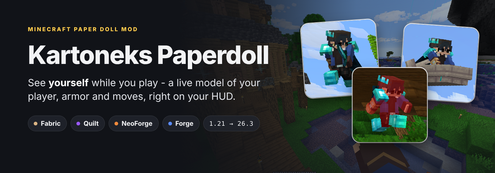
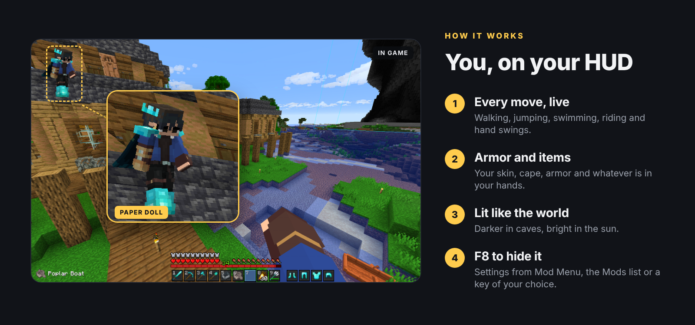
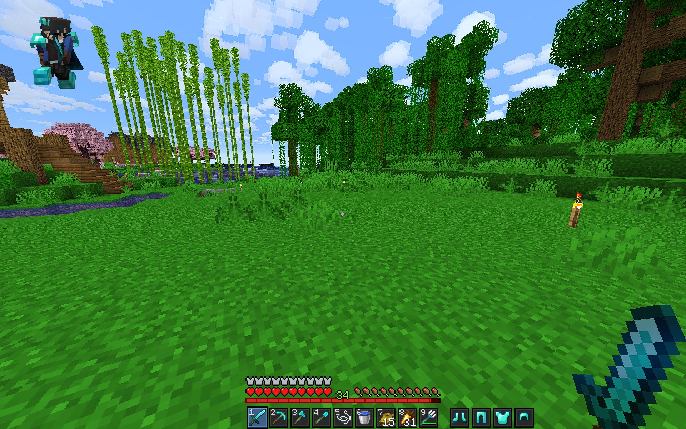
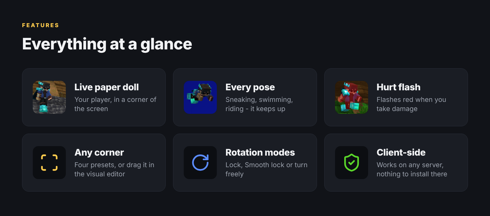
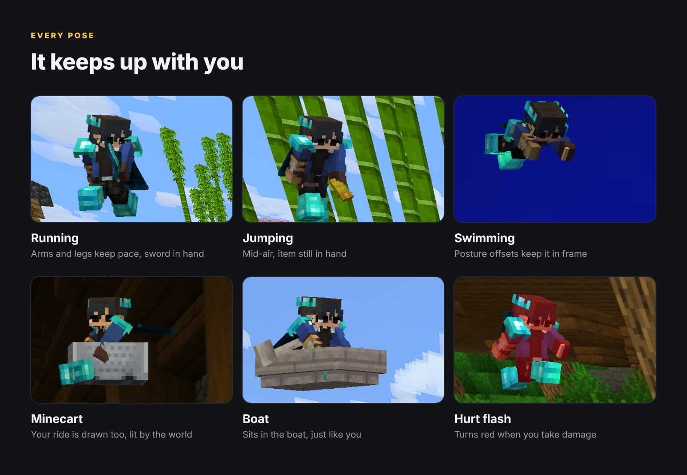
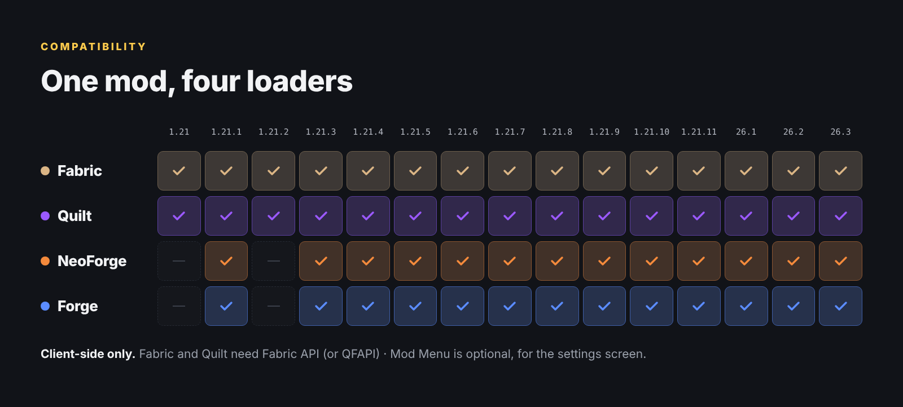

**See yourself while you play.** Kartoneks Paperdoll draws a live model of your player in a corner of the screen: your skin, armor and held items, copying every move you make.

## Setup
- **Fabric / Quilt** - needs [Fabric API](https://www.curseforge.com/minecraft/mc-mods/fabric-api) (QFAPI on Quilt); settings via [Mod Menu](https://www.curseforge.com/minecraft/mc-mods/modmenu) (optional)
- **NeoForge / Forge** - settings via *Mods → Kartoneks Paperdoll → Config*
- **F8** shows or hides the paper doll; a key to open the settings can be set in *Options → Controls*
- Client-side only - join any server

## Credits
A fork of [Ayame PaperDoll](https://www.curseforge.com/minecraft/mc-mods/ayame-paperdoll), itself a fork of [Extra Player Renderer](https://modrinth.com/mod/extraplayerrenderer). All credit for the mod itself goes to the original authors.

## Creator

