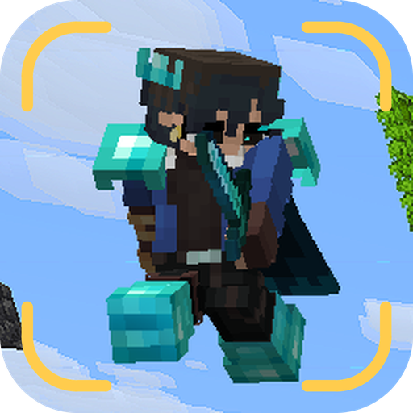

**See yourself while you play.** Kartoneks Paperdoll draws a live model of your player in a corner of the
screen: your skin, armor and held items, copying every move you make.

It is a fork of **Ayame PaperDoll**, starring Kartonek, the mascot of my projects. All credit for the mod
itself goes to the original authors; see [Credits](#credits).

**Download:** [Modrinth](https://modrinth.com/project/zWdPWnpB) | [CurseForge](https://www.curseforge.com/projects/1779628) | [GitHub releases](https://github.com/Kart-Modding/Kartoneks-PaperDoll/releases)


## Setup
- **Fabric / Quilt:** needs [Fabric API](https://modrinth.com/mod/fabric-api) ([QFAPI](https://modrinth.com/mod/qsl) on Quilt). Settings are in [Mod Menu](https://modrinth.com/mod/modmenu), which is optional.
- **NeoForge / Forge:** settings are in *Mods → Kartoneks Paperdoll → Config*.
- **F8** shows or hides the paper doll. A key that opens the settings can be set in *Options → Controls*.
- **Visual Configuration Editor:** in the settings, left-drag the doll to move it, right-drag to rotate it and scroll to resize it.
- Client-side only, so it works on any server.

## Versions and loaders


| Loader | Jar | Minecraft | Config screen |
|---|---|---|---|
| Fabric | `kartoneks-paperdoll-fabric` (needs Fabric API) | 1.21 – 26.3 | Mod Menu |
| Quilt | `kartoneks-paperdoll-fabric` (needs Fabric API / QFAPI) | 1.21 – 26.3 | Mod Menu |
| NeoForge | `kartoneks-paperdoll-neoforge` | 1.21.1, 1.21.3 – 26.3 | Mods list |
| Forge | `kartoneks-paperdoll-forge` | 1.21.1, 1.21.3 – 26.3 | Mods list |

Pick the jar whose name ends in your Minecraft version (`+1.21.8`, `+26.3`, ...). Jars for every
version are built by GitHub Actions on each push (Actions tab → latest run → Artifacts) and attached
to each GitHub release; a release `v<version>` is created automatically when `mod.version` changes on main.

## Building
The source tree is shared by every version with [Stonecutter](https://stonecutter.kikugie.dev/):
version- and loader-specific code sits in `//? if` comments.

```bash
./gradlew buildFabric     # or buildNeoforge / buildForge / chiseledBuild for everything
```

Jars land in `build/libs/<mod version>/`. Per-version dependencies are in `stonecutter.properties.toml`.

## Art
- **Icon:** the paper doll from the screenshot `Promotional Images/Original/2026-11-03_22.22.25.png`, framed by viewfinder corners.
  `art/paperdoll_icon.psd` holds the layers (Screenshot, Vignette, Corner brackets) and `art/paperdoll_icon.png` is the flat icon.
  `python3 art/paperdoll_icon.py` rebuilds both and copies the PNG to the `icon.png` files the loaders use.
  The previous icon, a 3D render of Kartonek, is still in `art/kartonek_icon.*` (`art/render.js` + `art/compose.py`).
- **Promotional images:** the infographics above, their layered PSDs and the screenshots they use are in
  [`Promotional Images/`](Promotional%20Images/README.md). `MODRINTH.md` and `CURSEFORGE.md` are the mod page descriptions.

## Credits
**Original mod, Ayame PaperDoll:** [Modrinth](https://modrinth.com/mod/ayame-paperdoll) | [CurseForge](https://www.curseforge.com/minecraft/mc-mods/ayame-paperdoll) | [McMod](https://www.mcmod.cn/class/17015.html)

Ayame PaperDoll is a highly configurable paper doll mod and a fork of [Extra Player Renderer](https://modrinth.com/mod/extraplayerrenderer).
It adds support for **NeoForge, Forge, Quilt and higher versions of Minecraft**, along with **more useful key bindings**,
**additional configuration options** (such as **Rotation Unlock**), and a **Visual Configuration Editor**.
